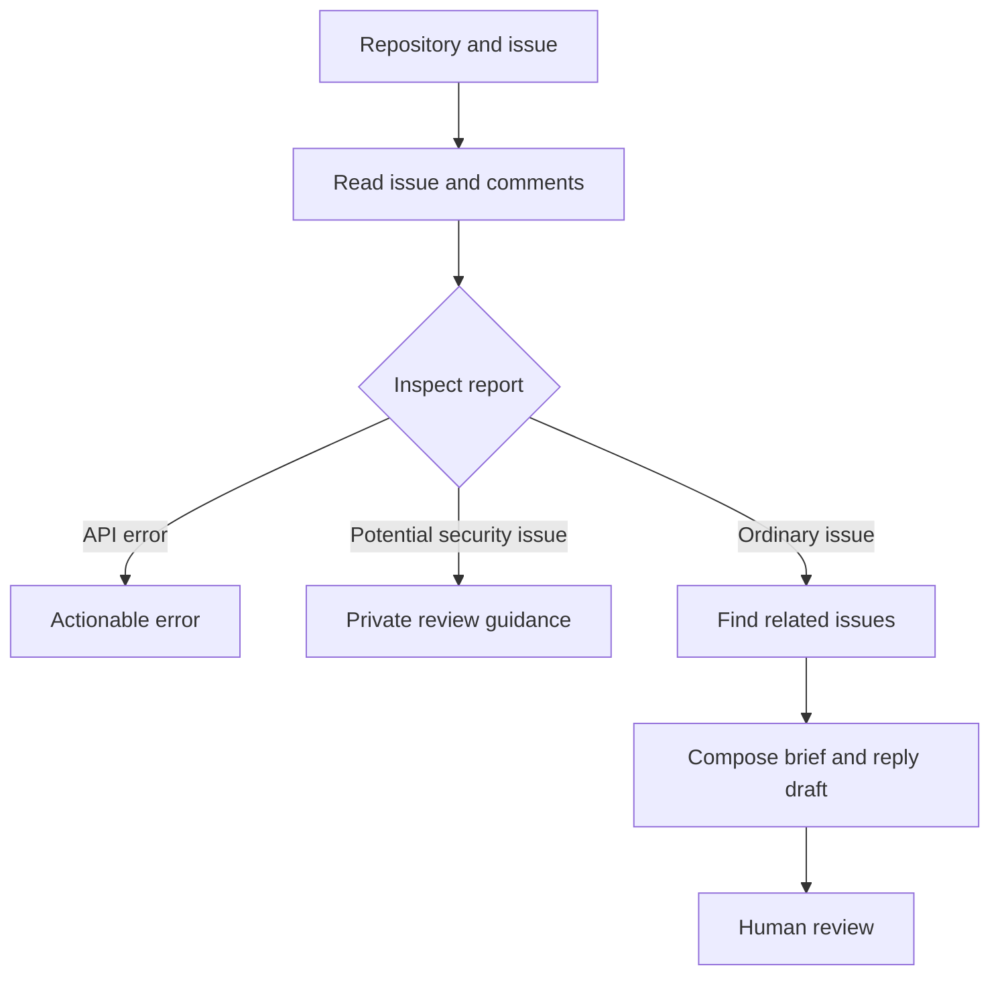

# GitHub Issue Triage for Dify

A small Dify SDK plugin and workflow for turning a public GitHub issue into an investigation brief: source context, information to confirm, related reports and a reply draft.

The workflow is read-only. It never posts a comment, changes labels, or closes an issue. It uses explicit rules rather than an LLM, so reviewers can run it without a model API key and inspect every decision.

## Deliverables and verification status

| Item | Location | Verified result |
| --- | --- | --- |
| Plugin source | [`plugin/`](plugin/) | Two SDK tools; installed in Dify Cloud |
| Installable package | [`dist/issue_triage-0.1.0.difypkg`](dist/issue_triage-0.1.0.difypkg) | Its Dify checksum matches the installed package and exported DSL |
| Workflow DSL | [`workflow/issue-triage.yml`](workflow/issue-triage.yml) | Actual Dify export, DSL version 0.7.0 |
| Tests | [`tests/`](tests/) | 31 passed locally |
| Platform verification | [`docs/verification.md`](docs/verification.md) | Successful seven-node Studio run, invalid-input branch and published Web App run |
| Issue triage assessment | [`docs/issue-triage-answers.md`](docs/issue-triage-answers.md) | Eight English analyses and reply drafts |
| English demo template | [`media/walkthrough-captioned.mp4`](media/walkthrough-captioned.mp4) | English captions and actual execution captures; silent, candidate voice pending |
| Dify Web App | [Try the Workflow](https://udify.app/workflow/5SgEngzA4VeBZeH3) | Published; complete run succeeded; anonymous page access returned HTTP 200 |

**Remaining candidate step:** record the candidate's own spoken English explanation. The captioned video is a recording template, not a completed candidate-narrated presentation. It includes a complete real Workflow execution. Use the [complete English rehearsal script](docs/walkthrough-script.md) and [walkthrough notes](docs/walkthrough-notes.md) to prepare your own explanation. The script allows a slower 4–5-minute delivery; retime the visuals to the recorded voice, and verify the final narrated video link before submitting.

## What it does

1. Accept `owner/repository` and a positive issue number.
2. Read public repository metadata, the issue, and up to five comments from GitHub's REST API.
3. Route API failures to an actionable error result. Route potential security reports to private-review guidance.
4. For ordinary reports, collect conservative context signals and choose an investigation checklist.
5. Call the plugin a second time to search related issue titles in the same repository.
6. Combine the evidence into a Markdown brief and a reply draft for human review. If search fails, still return the main brief.



## Requirements

- Python 3.12 for local development.
- A Dify workspace with permission to install custom tool plugins and create workflows.
- The official [Dify plugin CLI](https://github.com/langgenius/dify-plugin-daemon/releases).
- Outbound HTTPS access to `api.github.com`.
- Optional GitHub personal access token. Anonymous public reads work with lower rate limits.

The build uses `dify_plugin==0.10.2`, `httpx==0.28.1` and the official plugin CLI `0.6.11`. The manifest declares the base Dify minimum `1.0.0`; this is not a claim that every Dify version has been tested. The verified platform is Dify Cloud with DSL 0.7.0 export support; older deployments may need a compatible export.

## Install and configure

1. Download the `.difypkg` from `dist/` using GitHub's raw/download control.
2. In Dify, open **Integrations > Tools > Install > Local Package**. Older UI versions expose plugin installation under **Plugins**.
3. Select the package and inspect the displayed author, name, version and requested permissions. This plugin requests no Dify reverse-invocation or storage permissions.
4. Open **GitHub Issue Triage** in the installed tools and add a credential profile. The `GitHub token` field is optional: leave it blank for anonymous public reads. If your version requires a saved profile, save the blank profile as `Anonymous public access`.
5. If you use a token, put it only in the provider's secret credential field. Use the least privileges required for public issue reads. No repository write permission is needed. A supplied token is checked against `GET /user`; errors are sanitized.
6. In **Studio**, choose **Import DSL** and select `workflow/issue-triage.yml`.
7. Confirm both tool nodes resolve to `emptyteabot/issue_triage/issue_triage` and choose the credential profile. The actual export pins the installed package checksum and contains no credential values. Install the matching package first, then select your own workspace credential profile. If a Dify version requires rebinding, select **GitHub Issue Triage / Read public issue** and **Find related issues** in the respective nodes without changing their inputs.
8. Run the workflow and inspect its node traces in your workspace. The submitted DSL is already the actual export of the tested application. If you change it, publish and export your changed version again.

Do not globally weaken signature verification to make installation work. If the workspace disallows custom packages, use the workspace's supported development or trusted-package process with its administrator.

## Example

Enter:

```text
repository: langgenius/dify
issue_number: 36283
```

This public issue was used for the local live API check. Its content and state may change. Expected behavior: a connectivity-related signal, a request for any missing context, an ordered investigation checklist, keyword search candidates, and a reviewable reply. The report explicitly distinguishes a signal from a confirmed cause.

Additional checks:

- `repository: not a repo` should produce an actionable validation result without a network request.
- A nonexistent issue should produce `not_found`, not an invented diagnosis.
- A pull request number should be rejected as the wrong resource type.
- Search or comment failure should preserve useful context and clearly report the limitation.

## Local development and verification

```bash
python3.12 -m venv .venv
source .venv/bin/activate
pip install -r plugin/requirements.txt -r requirements-dev.txt
pytest -q
python scripts/build_workflow.py  # writes a separate .authored.yml; preserves the verified export
python scripts/live_smoke.py langgenius/dify 36283
# Replace dify-plugin with the actual path to the official CLI binary.
dify-plugin plugin package ./plugin -o ./dist/issue_triage-0.1.0.difypkg
```

The live smoke script invokes the real SDK tool adapters and the same Python functions embedded in the DSL. It makes actual GitHub API requests. It does **not** simulate a Dify runtime or prove import, installation, credential binding, publishing, or platform execution.

The video source capture archive is included at `media/capture-source.zip`; `scripts/build_captioned_video.py` rebuilds the silent template with Pillow and ffmpeg. These media tools are separate from plugin runtime dependencies.

For remote plugin development, use Dify's documented debugging connection and a local `.env` copied from `plugin/.env.example`. Never commit the remote debug key. A successful debug session should also be followed by a packaged-install test for the final submission.

## Tool contracts

The Workflow outputs `report` on the ordinary path and `attention_report` on the API-error or private-review path. Dify requires unique output names even for mutually exclusive end nodes.

Both tools yield explicit Dify variables named `status` and `payload_json`, plus a JSON message. `status` is `ok` or `error`. Workflow code parses `payload_json`, rather than assuming a particular shape for Dify's generic `json` output array.

| Tool | Inputs, all strings | Returned data |
| --- | --- | --- |
| `read_issue` | `repository`, `issue_number` | Issue metadata/body, first five comments, truncation/partial-fetch warnings |
| `related_issues` | `repository`, `keywords`, `exclude_number` | Up to five title-search candidates, exact query, incomplete-result flag |

Expected failures use an envelope such as:

```json
{"ok": false, "error": {"code": "not_found", "message": "Repository or issue not found, or not visible to this credential. Check the public repository and issue number.", "http_status": 404, "request_id": "..."}}
```

## Technical choices and limits

- **Small API surface:** public GitHub REST reads only. Repository syntax is validated; the API host is fixed; redirects are refused. User text cannot supply an arbitrary endpoint.
- **Bounded work:** 5-second connect / 15-second per-request timeouts, first five comments, limited body size, six search results before filtering to at most five. No automatic retry storm. An ordinary run makes up to five HTTP requests, including two repository-visibility checks.
- **Credential handling:** optional secret input, header-based authorization, no token in DSL, no token logging, and no raw upstream error-body reflection.
- **No model dependency:** rules are easy to inspect and reproduce. The trade-off is limited language understanding; English keywords may miss reports or overflag benign text. Context checks detect signals, not completeness or correctness.
- **Search is evidence retrieval:** title keywords are neither semantic similarity nor proof of duplication. No results does not establish novelty.
- **Security handling:** flagged reports skip related search and omit issue text from the final brief. The earlier tool output can still exist in Dify execution logs. Restrict log access and follow the repository's private disclosure policy.
- **No automatic action:** every reply needs human review. An LLM drafting node could be added later, with issue text treated as untrusted input, but it is not required for this demo.

## Reference documentation

- [Dify tool plugin guide](https://docs.dify.ai/en/develop-plugin/dev-guides-and-walkthroughs/tool-plugin)
- [Dify tool output schema](https://docs.dify.ai/en/develop-plugin/features-and-specs/plugin-types/tool)
- [Dify package distribution](https://docs.dify.ai/en/develop-plugin/publishing/marketplace-listing/release-by-file)
- [GitHub REST issues](https://docs.github.com/en/rest/issues/issues)
- [GitHub REST search](https://docs.github.com/en/rest/search/search)
- [GitHub REST rate limits](https://docs.github.com/en/rest/using-the-rest-api/rate-limits-for-the-rest-api)

AI coding assistance was used to develop this project. The candidate should review the implementation, verify it in Dify, and explain its behavior and trade-offs in their own words.
